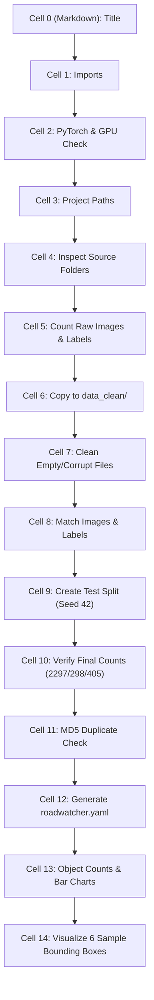

# Notebook 01: Data Preparation & EDA — Cell-by-Cell Guide

This document explains every single cell in [`notebooks/01_prepare_data.ipynb`](file:///d:/Coding/RoadWatcher/notebooks/01_prepare_data.ipynb) in clear, simple terms. It is written for beginners, breaking down what the code does, why it is necessary, and what output to expect.

---

## Overview

The purpose of this notebook is to take the raw road traffic vehicle dataset (from Bangladeshi roads) and prepare it for YOLOv9 training:
1. Check that PyTorch and GPU are accessible.
2. Inspect the raw files and count how many images and label files exist.
3. Make a safe working copy in `data_clean/` (so raw data is never touched).
4. Remove empty labels, corrupt images, and unmatched files.
5. Move exactly 405 images from training to a dedicated `test/` folder with seed 42 (so results are 100% reproducible).
6. Verify the split sizes match the project brief (2,297 train, 298 valid, 405 test).
7. Check for duplicate images using cryptographic hashing (MD5).
8. Generate the dataset configuration file (`roadwatcher.yaml`).
9. Plot the class distribution of vehicles and draw sample bounding boxes.

---

## Cell-by-Cell Detailed Breakdown



---

### Cell 0: Title & Introduction
- **Type:** Markdown
- **What it does:** Introduces the notebook and explains its overall purpose.
- **Why it matters:** Gives anyone opening the notebook immediate context about what this notebook will do and why it should be executed from top to bottom.

---

### Cell 1: Imports
- **Type:** Code
- **What it does:** Imports standard Python libraries:
  - `os`, `shutil`: Creating folders, copying, and moving files.
  - `random`: Shuffling images with a fixed random seed.
  - `hashlib`: Generating file hashes to check for duplicate images.
  - `pathlib.Path`: Clean, modern path manipulation.
  - `collections.Counter`: Counting object frequencies easily.
  - `PIL.Image`, `PIL.ImageDraw`: Opening images and drawing bounding boxes.
  - `matplotlib.pyplot`: Plotting class distribution charts and displaying images.
  - `yaml`: Reading and writing `.yaml` configuration files.
- **Why it matters:** Loads all necessary tools in one place at the start.
- **Expected output:** Runs silently with no errors.

---

### Cell 2: Check GPU and PyTorch
- **Type:** Code
- **What it does:** Checks `torch.__version__` and whether CUDA (GPU support) is active via `torch.cuda.is_available()`. If a GPU is present, it prints its name (e.g., NVIDIA RTX 3090, T4, etc.).
- **Why it matters:** Object detection models require GPU acceleration for fast training. Verifying this early avoids running into slow CPU execution later.
- **Expected output:**
  ```text
  PyTorch version: 2.x.x
  CUDA available: True
  GPU: NVIDIA ...
  ```

---

### Cell 3: Project Paths
- **Type:** Code
- **What it does:** Defines key directories using `Path`:
  - `project_dir`: Root folder of the repository.
  - `src_dir`: `trafic_data/` (the original raw dataset).
  - `data_dir`: `data_clean/` (the destination folder where cleaned data will be placed).
- **Why it matters:** Using centralized path variables prevents hardcoded strings and makes the code work smoothly across any machine (local or Vast.ai).
- **Expected output:** Prints the absolute paths to project, source data, and clean dataset folders.

---

### Cell 4: Inspect Source Dataset Folders
- **Type:** Code
- **What it does:** Uses `os.listdir()` to list all files and subfolders inside `trafic_data/`.
- **Why it matters:** Good data practice (EDA). Before modifying any files, you want to inspect what the raw download looks like (folders like `train/`, `valid/`, and config files like `data_1.yaml`).
- **Expected output:**
  ```text
  Source directory contents:
  Folder: train/
  Folder: valid/
  File:   data_1.yaml
  ```

---

### Cell 5: Count Images and Labels in Raw Dataset
- **Type:** Code
- **What it does:** Counts how many image files (`.jpg`, `.png`, etc.) and how many `.txt` annotation files exist inside `train/` and `valid/`.
- **Why it matters:** Verifies the baseline dataset size before any preprocessing. In the raw dataset, there are 2,704 training images and 300 validation images.
- **Expected output:**
  ```text
  TRAIN -> Images: 2704, Labels: 2704
  VALID -> Images: 300, Labels: 300
  ```

---

### Cell 6: Copy Raw Data to data_clean/
- **Type:** Code
- **What it does:** Uses `shutil.copytree()` to duplicate `trafic_data/` into `data_clean/`. Skips old `.cache` files. If `data_clean/` already exists, it skips copying so it doesn't overwrite your work if you re-run the cell.
- **Why it matters:** **Safety.** Never clean or delete files in your original raw dataset directly. Working in a copy ensures you can always start over if something goes wrong.
- **Expected output:**
  ```text
  Copied raw data to: .../data_clean
  ```

---

### Cell 7: Check for Empty Labels and Corrupt Images, and Clean Them
- **Type:** Code
- **What it does:** Loops through each image and label:
  1. Checks if the label file exists and is not empty (`read_text().strip() != ""`).
  2. Uses `Image.open(img).verify()` to verify the image file is not corrupted.
  3. If an image is corrupt or has an empty label, both the image and label are deleted using `.unlink()`.
- **Why it matters:** Corrupt images or empty/broken labels will crash YOLO training mid-way. Cleaning them up front guarantees stable training.
- **Expected output:**
  ```text
  train: deleted 1 empty/missing labels and 0 corrupt images
  valid: deleted 1 empty/missing labels and 0 corrupt images
  ```

---

### Cell 8: Check Image and Label Matching
- **Type:** Code
- **What it does:** Compares the set of image file stems (filenames without extension) with the set of label file stems using set subtraction (`images - labels` and `labels - images`). If any orphan image or orphan label exists, it is deleted.
- **Why it matters:** In YOLO, every image MUST have a matching `.txt` label file with the exact same stem name. Having an image without a label or a label without an image causes mismatches.
- **Expected output:**
  ```text
  TRAIN: images=2702, labels=2702, perfect match=True
  VALID: images=298, labels=298, perfect match=True
  ```

---

### Cell 9: Create Reproducible Test Split (405 Images from Train)
- **Type:** Code
- **What it does:**
  1. Creates the `test/images/` and `test/labels/` directories.
  2. If `test/` is empty, it sorts the training images, sets `random.seed(42)`, shuffles them, and moves the first 405 images along with their labels into `test/`.
  3. If `test/` already has images, it skips re-moving to preserve the existing split.
- **Why it matters:**
  - The project brief specifically requires a test split of **exactly 405 images** carved out from training.
  - Setting `random.seed(42)` guarantees that anyone running this code gets the **exact same 405 test images**, ensuring scientific reproducibility.
- **Expected output:**
  ```text
  Moved 405 images to test set
  ```

---

### Cell 10: Verify Final Split Counts
- **Type:** Code
- **What it does:** Counts the images and labels in each split (`train`, `valid`, `test`) and compares them against the project brief requirements:
  - Train: 2,297 images
  - Valid: 298 images
  - Test: 405 images
- **Why it matters:** Acceptance criteria check. Proves that data preparation achieved the exact numbers required by the project specifications.
- **Expected output:**
  ```text
  TRAIN -> Images: 2297, Labels: 2297 (Expected: 2297)
  VALID -> Images: 298, Labels: 298 (Expected: 298)
  TEST -> Images: 405, Labels: 405 (Expected: 405)
  ```

---

### Cell 11: Check for Exact Duplicate Images Using MD5 Hash
- **Type:** Code
- **What it does:** Computes the MD5 cryptographic checksum of every image across all splits. If two files have the same MD5 hash, they are 100% identical byte-for-byte.
- **Why it matters:** **Data leakage prevention.** If identical images exist in both the training set and the test set, the model might simply "memorize" those images rather than generalize, giving falsely high test scores. This cell verifies whether cross-split duplicates exist.
- **Expected output:**
  ```text
  Total exact duplicates found across splits: 1 (or 0 cross-split duplicates)
  ```

---

### Cell 12: Read Class Names and Create roadwatcher.yaml
- **Type:** Code
- **What it does:** Reads `data_1.yaml` from the source directory to retrieve the 21 vehicle class names and class count (`nc: 21`). Then writes a clean configuration file called `roadwatcher.yaml` in the project root:
  - `path`: Absolute path to `data_clean/`
  - `train`: `train/images`
  - `val`: `valid/images`
  - `test`: `test/images`
  - `nc`: 21
  - `names`: List of 21 vehicle names
- **Why it matters:** YOLOv9 reads this YAML file to know where the dataset is located and what names correspond to class IDs 0 through 20.
- **Expected output:** Prints the 21 class names and displays the generated `roadwatcher.yaml` contents.

---

### Cell 13: Count Objects Per Class and Plot Distribution
- **Type:** Code
- **What it does:** Loops through all `.txt` label files in `train`, `valid`, and `test`. For each line, it reads the class ID and increments a counter. It prints the total object count per class and displays a Matplotlib bar chart for each split.
- **Why it matters:** **Class imbalance analysis.** In real-world road traffic datasets, common classes (like `car`, `bus`, `rickshaw`, `three wheelers -CNG-`) have thousands of examples, while rare classes (like `ambulance`, `garbagevan`, `policecar`) have fewer than 50 examples. Understanding this imbalance explains why the model will perform better on some classes than others.
- **Expected output:** Prints tables of object counts per class and renders 3 bar charts (one for TRAIN, one for VALID, one for TEST).

---

### Cell 14: Visualize 6 Sample Images with Bounding Boxes
- **Type:** Code
- **What it does:** Loads 6 training images using PIL, reads their corresponding YOLO bounding box labels:
  - YOLO format is: `class_id  x_center  y_center  width  height` (normalized between 0 and 1).
  - Converts normalized values to pixel coordinates:
    $$\text{x}_1 = (x_{\text{center}} - \frac{\text{width}}{2}) \times \text{image\_width}$$
    $$\text{y}_1 = (y_{\text{center}} - \frac{\text{height}}{2}) \times \text{image\_height}$$
  - Draws a red bounding box and yellow class label on each vehicle.
  - Displays the 6 images in a 2x3 grid using Matplotlib.
- **Why it matters:** Visual verification. Confirms that our coordinates, label parser, and class mappings match real vehicles correctly before training begins.
- **Expected output:** Displays a clean 2x3 grid showing 6 road traffic images with labeled vehicle bounding boxes.
