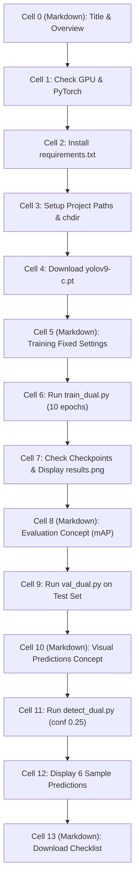

# Notebook 02: Train and Evaluate YOLOv9-C — Cell-by-Cell Guide

This document explains every single cell in [`notebooks/02_train_and_evaluate.ipynb`](file:///d:/Coding/RoadWatcher/notebooks/02_train_and_evaluate.ipynb) in clear, simple terms. It covers what each cell does, why it is needed, key machine learning concepts, and what output to expect when running on a GPU machine (e.g. Vast.ai).

---

## Overview

This notebook handles the model training and evaluation phase of the RoadWatcher project:
1. Verifies that PyTorch can access the GPU.
2. Installs required packages from `requirements.txt`.
3. Sets up working directories and downloads pretrained YOLOv9-C weights (`yolov9-c.pt`).
4. Trains the YOLOv9-C model on the prepared vehicle dataset using `train_dual.py`.
5. Visualizes training curves (losses, precision, recall, mAP) from `results.png`.
6. Evaluates the trained model on the 405 test images with `val_dual.py`.
7. Generates visual detection predictions with `detect_dual.py` and displays sample test images.
8. Highlights critical checkpoints (`best.pt`, `last.pt`) to download before stopping the GPU instance.

---

## Cell-by-Cell Detailed Breakdown



---

### Cell 0: Title & Overview
- **Type:** Markdown
- **What it does:** Introduces the notebook, stating its purpose: training YOLOv9-C, evaluating on test data, and visualizing predictions.
- **Why it matters:** Establishes context and workflow for anyone reviewing or running the notebook.

---

### Cell 1: Imports and Environment Check
- **Type:** Code
- **What it does:** Imports standard libraries (`os`, `sys`, `urllib.request`, `pathlib.Path`, `torch`) and checks CUDA availability:
  - Prints PyTorch version.
  - Checks if a GPU is accessible via `torch.cuda.is_available()`.
  - Prints the GPU device model name (e.g., RTX 3090, RTX 4090, A100).
- **Why it matters:** YOLOv9-C requires a CUDA-capable GPU. Running training on a CPU would take days, so verifying the GPU is essential before starting.
- **Expected output:**
  ```text
  PyTorch version: 2.x.x
  CUDA available:  True
  GPU device:      NVIDIA RTX ...
  ```

---

### Cell 2: Install Dependencies
- **Type:** Code
- **What it does:** Runs `!pip install -q -r ../yolov9/requirements.txt` to install all necessary packages (PyYAML, torchvision, pandas, seaborn, tqdm, etc.) into the active Jupyter kernel.
- **Why it matters:** Ensures all libraries required by YOLOv9 scripts are installed and compatible.
- **Expected output:** Installs packages quietly without errors.

---

### Cell 3: Setup Paths and Working Directory
- **Type:** Code
- **What it does:**
  - Defines paths to `project_dir`, `yolo_dir`, `data_yaml` (`roadwatcher.yaml`), and `data_dir` (`data_clean/`).
  - Asserts that `roadwatcher.yaml` exists (verifying notebook 01 was completed first).
  - Uses `os.chdir(yolo_dir)` to switch the current working directory into `yolov9/`.
- **Why it matters:** The official YOLOv9 scripts (`train_dual.py`, `val_dual.py`, `detect_dual.py`) rely on relative paths to internal modules like `models/` and `utils/`. Running from inside `yolov9/` avoids path errors.
- **Expected output:**
  ```text
  Project folder:  .../RoadWatcher
  YOLO directory:  .../RoadWatcher/yolov9
  Data YAML:       .../RoadWatcher/roadwatcher.yaml
  Current directory: .../RoadWatcher/yolov9
  ```

---

### Cell 4: Download Pretrained Weights (yolov9-c.pt)
- **Type:** Code
- **What it does:** Checks if `yolov9-c.pt` already exists in `yolov9/`. If not, it automatically downloads the official release weights from GitHub using `urllib.request.urlretrieve()`.
- **Why it matters:** **Transfer Learning.** Starting training from scratch (random numbers) on a small dataset would take hundreds of epochs and perform poorly. By using pretrained weights trained on the massive COCO dataset, the model already knows how to detect edges, shapes, and general objects. Training on our data fine-tunes that knowledge for our specific 21 vehicle classes.
- **Expected output:**
  ```text
  Downloading yolov9-c.pt pretrained weights...
  Download finished!
  ```

---

### Cell 5: Training Setup & Fixed Parameters
- **Type:** Markdown
- **What it does:** Documents the fixed hyperparameters defined by the project brief:
  - Architecture: `models/detect/yolov9-c.yaml`
  - Pretrained weights: `yolov9-c.pt`
  - Image size: 640 pixels
  - Batch size: 4
  - Epochs: 10
  - Hyperparameter file: `data/hyps/hyp.scratch-high.yaml`
- **Why it matters:** Ensures experimental transparency and confirms that training strictly adheres to the project rules.

---

### Cell 6: Launch Training with train_dual.py
- **Type:** Code
- **What it does:** Executes the main YOLOv9 training command:
  ```bash
  !python train_dual.py \
      --device 0 \
      --workers 2 \
      --img 640 \
      --batch-size 4 \
      --epochs 10 \
      --data ../roadwatcher.yaml \
      --cfg models/detect/yolov9-c.yaml \
      --weights yolov9-c.pt \
      --hyp data/hyps/hyp.scratch-high.yaml \
      --name roadwatcher_yolov9c \
      --min-items 0 \
      --close-mosaic 2 \
      --exist-ok
  ```
  - `--device 0`: Uses the primary GPU.
  - `--workers 2`: Number of dataloader CPU threads.
  - `--img 640`: Resizes images to 640x640 with letterboxing.
  - `--batch-size 4`: Processes 4 images per forward/backward pass.
  - `--epochs 10`: Completes 10 full passes over the 2,297 training images.
  - `--close-mosaic 2`: Disables mosaic augmentation during the last 2 epochs to help bounding boxes stabilize.
- **Why it matters:** This is the core machine learning step where model weights are updated to learn road vehicle detection.
- **Expected output:** A live progress bar for each epoch showing box loss, class loss, DFL loss, and validation mAP metrics. Outputs are saved to `runs/train/roadwatcher_yolov9c/`.

---

### Cell 7: Check Checkpoints and Display Training Loss Curves
- **Type:** Code
- **What it does:**
  - Verifies that `best.pt` (weights from the epoch with highest validation score) and `last.pt` (final epoch weights) were saved in `runs/train/roadwatcher_yolov9c/weights/`.
  - Displays `results.png` using IPython Display, showing curves for training losses, validation losses, Precision, Recall, mAP@0.5, and mAP@0.5:0.95 over the 10 epochs.
- **Why it matters:** Allows you to quickly assess whether the model learned properly, whether loss was decreasing steadily, or if more epochs might be beneficial.
- **Expected output:** Displays `best.pt exists: True` and renders the multi-panel training metric graph.

---

### Cell 8: Evaluation Concept Header (mAP)
- **Type:** Markdown
- **What it does:** Explains the difference between evaluation and visualization:
  - Evaluation uses a very low confidence threshold (`--conf-thres 0.001`) to assess all candidate boxes and compute accurate Precision-Recall curves and mean Average Precision (mAP).
- **Why it matters:** Distinguishing evaluation parameters from visualization parameters is explicitly required by the project brief.

---

### Cell 9: Evaluate on the 405 Test Images
- **Type:** Code
- **What it does:** Runs `val_dual.py` on the test split:
  ```bash
  !python val_dual.py \
      --data ../roadwatcher.yaml \
      --weights runs/train/roadwatcher_yolov9c/weights/best.pt \
      --img 640 \
      --batch-size 4 \
      --conf-thres 0.001 \
      --iou-thres 0.7 \
      --task test \
      --verbose \
      --exist-ok
  ```
  - `--task test`: Specifically tells the script to evaluate on `test/images` (not validation).
  - `--verbose`: Prints per-class performance tables.
- **Why it matters:** Generates the official quantitative test benchmark: Precision, Recall, mAP@50, and mAP@50-95 for each of the 21 vehicle classes.
- **Expected output:** A formatted summary table listing per-class and overall test metrics.

---

### Cell 10: Visual Predictions Concept
- **Type:** Markdown
- **What it does:** Explains that for visual display, we use `--conf-thres 0.25` so that only high-confidence bounding boxes are drawn on images for human inspection.
- **Why it matters:** At confidence 0.001, images would be covered in thousands of faint candidate boxes. A threshold of 0.25 produces clean, human-readable images.

---

### Cell 11: Run Inference on Test Images
- **Type:** Code
- **What it does:** Executes `detect_dual.py`:
  ```bash
  !python detect_dual.py \
      --weights runs/train/roadwatcher_yolov9c/weights/best.pt \
      --source ../data_clean/test/images \
      --data ../roadwatcher.yaml \
      --img 640 \
      --conf-thres 0.25 \
      --iou-thres 0.45 \
      --project runs/detect \
      --name roadwatcher_test \
      --exist-ok
  ```
- **Why it matters:** Takes test images that the model has never seen, detects vehicles, draws bounding boxes with class labels and confidence percentages, and saves annotated images into `runs/detect/roadwatcher_test/`.
- **Expected output:** Progress output showing detected vehicles in each test image.

---

### Cell 12: Display Sample Predictions
- **Type:** Code
- **What it does:** Finds all generated prediction images in `runs/detect/roadwatcher_test/` and displays the first 6 images inline using IPython's `display(DisplayImage(...))`.
- **Why it matters:** Qualitative evaluation (visual inspection). Allows you to inspect:
  - True Positives: Correctly identified vehicles.
  - False Positives: Spurious or misclassified boxes.
  - False Negatives: Vehicles missed by the model.
- **Expected output:** Prints filenames and renders 6 vehicle images with detected bounding boxes.

---

### Cell 13: Summary of Important Outputs to Download
- **Type:** Markdown
- **What it does:** Reminds the user to download essential files before destroying their Vast.ai instance:
  1. `best.pt` and `last.pt` checkpoints.
  2. `results.png` (training plots).
  3. Visual prediction images from `runs/detect/roadwatcher_test/`.
- **Why it matters:** Cloud instances on Vast.ai are ephemeral; all data is wiped when an instance is terminated. Downloading key artifacts ensures you preserve your results for your report or presentation.
