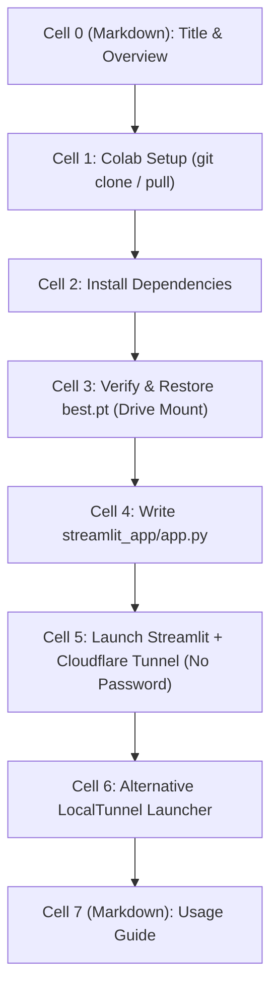

# Notebook 03: Deploy RoadWatcher with Streamlit — Cell-by-Cell Guide

This document explains every single cell in [`notebooks/03_deploy_streamlit.ipynb`](file:///d:/Coding/RoadWatcher/notebooks/03_deploy_streamlit.ipynb) in clear, simple terms. It explains how to build and host an interactive vehicle detection web application using Streamlit and YOLOv9-C on Google Colab or your local machine.

---

## Overview

This notebook takes the model weights trained in Notebook 02 (`best.pt`) and deploys them into an interactive web interface:
1. Setup Google Colab environment and repository paths (with auto `git pull`).
2. Install dependencies (`streamlit` and YOLO requirements).
3. Verify that `best.pt` exists (automatically mounts Google Drive to restore `best.pt`, or downloads `yolov9-c.pt` fallback).
4. Write the standalone Streamlit application script (`streamlit_app/app.py`).
5. Launch the Streamlit server with Cloudflare Tunnel (`cloudflared`) — instant password-free HTTPS link with full slider and widget support.
6. Optional alternative: LocalTunnel launcher.
7. Step-by-step instructions for interacting with the app.

---

## Cell-by-Cell Detailed Breakdown

---

### Cell 0: Title & Introduction
- **Type:** Markdown
- **What it does:** Introduces Notebook 03 and outlines its goal: deploying an interactive web application that accepts user-uploaded images and runs live YOLOv9-C vehicle detection.

---

### Cell 1: Colab Setup
- **Type:** Code
- **What it does:**
  - Clones the repository if not present, or automatically runs `git -C /content/RoadWatcher pull` if already cloned.
  - Switches directory to `/content/RoadWatcher/notebooks`.
- **Expected output:** `Working directory: /content/RoadWatcher/notebooks`

---

### Cell 2: Install Dependencies for Streamlit and YOLOv9
- **Type:** Code
- **What it does:** Installs `streamlit` and YOLOv9 requirements.

---

### Cell 3: Verify Trained Weights (best.pt) and Mount Google Drive
- **Type:** Code
- **What it does:**
  - Automatically mounts Google Drive via `google.colab.drive.mount()` to restore `/content/drive/MyDrive/RoadWatcher/best.pt`.
  - Checks if weights exist. If neither `best.pt` nor `yolov9-c.pt` is on disk, it downloads `yolov9-c.pt` so the app always has working weights.
- **Expected output:** Displays whether `best.pt` was found and restored.

---

### Cell 4: Write the Streamlit Application File (app.py)
- **Type:** Code
- **What it does:** Generates `streamlit_app/app.py`:
  - Confidence and IoU sliders.
  - Model loader with `@st.cache_resource`.
  - **In-app file uploader for weights**: If weights are missing, it lets you drag-and-drop `best.pt` directly into the web page.
  - Image preprocessing with letterbox.
  - Full YOLOv9 inference with bounding box rendering and detection summary table.

---

### Cell 5: Launch Streamlit + Cloudflare Tunnel (Recommended)
- **Type:** Code
- **What it does:**
  - Starts the Streamlit server in the background on port 8501.
  - Starts a Cloudflare Tunnel (`cloudflared`) to generate an instant `https://...trycloudflare.com` URL.
- **Why it matters:** Unlike LocalTunnel, Cloudflare Tunnel requires **NO password**, does not show an interstitial warning screen, and never drops JavaScript chunk modules (fixing the `TypeError: Failed to fetch dynamically imported module: Slider` error).

---

### Cell 6: Alternative LocalTunnel Launcher
- **Type:** Code
- **What it does:** Fallback launcher using `localtunnel` with public IP password retrieval.

---

### Cell 7: How to Use the Streamlit App
- **Type:** Markdown
- **What it does:** Instructions on uploading road images and testing vehicle detections.
